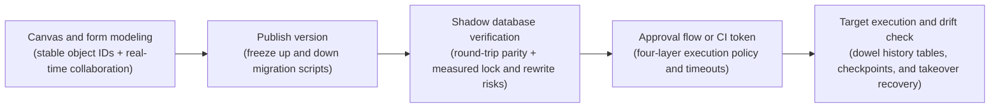

# Dowel docs

Dowel is an open-source, self-hosted database schema modeling and migration platform with real-time multiplayer collaboration. It supports PostgreSQL 15 to 19, SQLite, MySQL 8.4 and 9.7, and SQL Server 2019, 2022, and 2025 as target databases.

## Core workflow {#core-workflow}

## Quick links {#quick-links}

### Deployment and setup {#entry-deploy}

- [Getting started](getting-started.md). Start Dowel with Docker Compose, create the initial instance admin, create a project with the four-step wizard, verify migrations, and execute to a target database.
- [Deployment and configuration](deployment.md). Review all 20 server environment variables, source build commands, high availability without Redis on external PostgreSQL, reverse proxy setup, and connection allowlists.
- [Accounts, OIDC, and access](accounts-and-access.md). Manage users and invites, Google, GitLab, and generic OIDC sign-in, group and project grants, audit logs, and personal settings.

### Modeling and dialects {#entry-modeling}

- [Modeling, versions, and canvas history](modeling.md). Learn how Dowel tracks renames by stable object ID, imports schemas from a database or SQL, isolates shadow databases, tracks canvas history for restore, edits PostgreSQL partitioned tables, and analyzes migration risks.
- [Dialects and version support](dialects.md). Compare connection schemes, feature matrices, version checks, and limits across PostgreSQL 15 to 19, SQLite, MySQL 8.4 and 9.7, and SQL Server 2019, 2022, and 2025.
- [Takeover and disaster recovery](takeover.md). Restore a full version chain from target database migration history, merge multiple environments, claim a project for a new instance, and recover when the platform database is lost.

### Execution and governance {#entry-governance}

- [Execution, rollback, and drift](execution.md). Read about dry runs, claiming, `dowel` history table schemas, checkpoint resume for non-transactional and auto-commit DDL, drift resolution, and mark as applied.
- [Execution policy and executors](execution-policy.md). Understand four-layer policy merging across instance, group, project, and environment, privileged operations, and executor grants.
- [Execution requests and approvals](approvals.md). Follow multi-stage approval flows, binding and invalidation checks, emergency execution by instance admins, and the inbox.
- [Group webhooks](webhooks.md). Configure generic JSON, DingTalk, Feishu, WeCom, and Slack payloads, HMAC signature verification, and outbound SSRF restrictions.

### CI and reference {#entry-ci}

- [CI HTTP API](api.md). Check CI token security boundaries, read-only endpoints, live drift checks, forward execution endpoints, and the complete error code reference.
- [CI pipeline integration](ci-action.md). Run `actions/execute` in GitHub, Gitea, Forgejo, GHES, or any shell pipeline.
- [Glossary](glossary.md). Read canonical definitions for Dowel platform concepts and terms.
