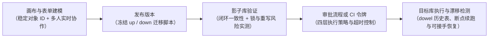

# Dowel 文档

Dowel 是开源、可自托管、支持多人实时协作的数据库 schema 建模与迁移平台，当前目标库支持 PostgreSQL（15–19）、SQLite、MySQL（8.4 / 9.7）与 SQL Server（2019 / 2022 / 2025）。

## 核心工作流 {#core-workflow}

## 按任务直达 {#quick-links}

### 部署与初始化 {#entry-deploy}

- [上手指南](getting-started.md)：Docker Compose 启动、初始化管理员、四步向导建项目与最小验证执行闭环。
- [部署与配置](deployment.md)：22 项服务端环境变量、源码构建、外部 PostgreSQL 多副本高可用（无 Redis）、反向代理与连接白名单。
- [账户、OIDC 与权限](accounts-and-access.md)：用户与邀请、Google/GitLab/通用 OIDC、组与项目授权、审计日志与个人设置。

### 建模与多方言 {#entry-modeling}

- [建模、版本与画布历史](modeling.md)：稳定对象 ID 改名识别、目标库或 SQL 导入、实时协作与画布修改历史恢复、PostgreSQL 分区表编辑与风险分析。
- [多方言与版本支持](dialects.md)：PostgreSQL 15–19、SQLite、MySQL 8.4/9.7、SQL Server 2019/2022/2025 的连接方式、特性矩阵、版本检查与限制。
- [接手现有项目与灾难恢复](takeover.md)：从目标库迁移历史恢复完整版本链、多环境合并、认领实例与平台库丢失后的恢复步骤。

### 执行与治理 {#entry-governance}

- [执行迁移、回滚与漂移](execution.md)：预演（dry run）、认领、`dowel` 历史表结构、非事务与隐式提交断点续跑、漂移处理与标记为已执行。
- [执行策略与执行者](execution-policy.md)：实例 → 组 → 项目 → 环境四层策略收紧规则、特权操作与执行者授权。
- [执行申请与审批](approvals.md)：多环节审批流程、绑定与失效校验、实例管理员紧急执行与站内收件箱。
- [组级 Webhook](webhooks.md)：通用 JSON、钉钉、飞书、企业微信、Slack 报文格式、HMAC 签名校验与 SSRF 出站控制。

### CI 与参考 {#entry-ci}

- [CI HTTP API](api.md)：CI 令牌权限边界、只读查询、实时漂移检测、向前执行端点与完整错误码表。
- [CI 流水线集成](ci-action.md)：在 GitHub / Gitea / Forgejo / GHES 或任意 shell 流水线中使用 `actions/execute`。
- [术语表](glossary.md)：平台核心概念与规范用语说明。
